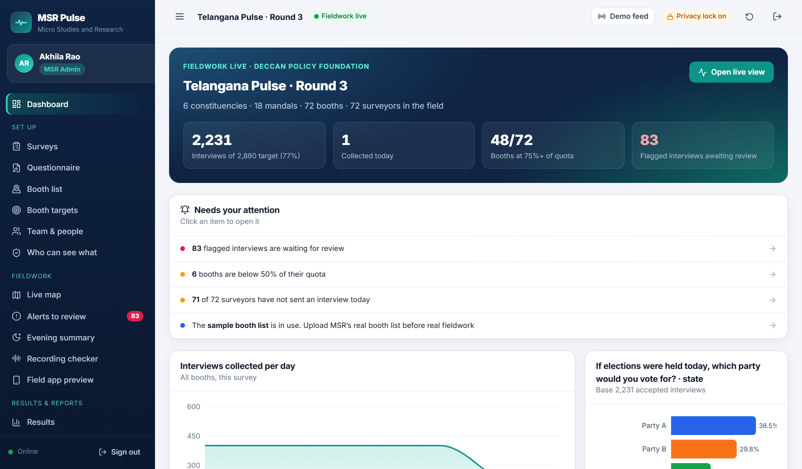
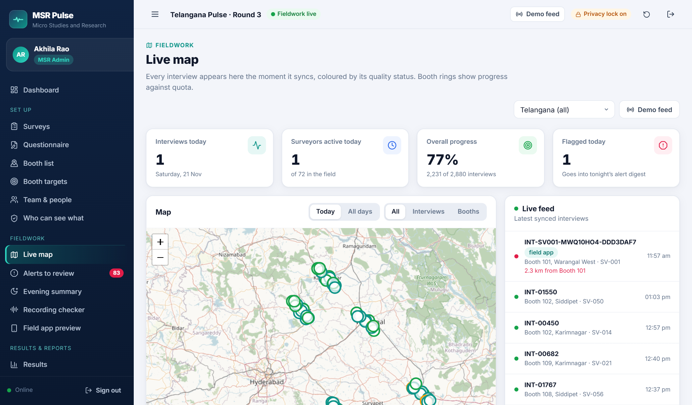
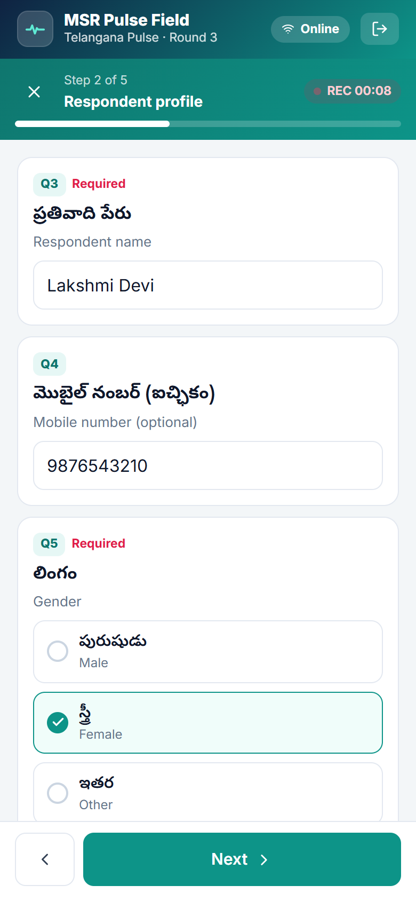
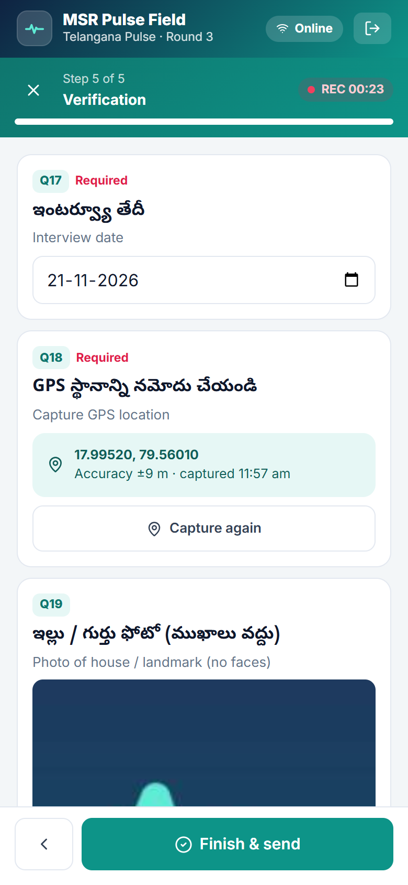
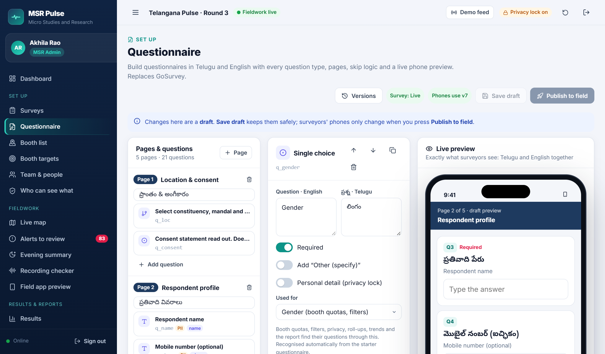

# FieldPulse

**Survey platform for field research teams: questionnaire to client report.**
It handles the questionnaire design, offline interviews on phones, live quality checks, results and the approved client report.

It was built for opinion polls in Telangana: Telugu and English, booth-level targets, and teams of field surveyors.
The engine itself is generic. It suits any survey run by people in the field:
- market research and customer feedback;
- NGO and CSR impact studies;
- health and agriculture surveys;
- retail audits and inspections.

<p align="center">
  
  
</p>
<p align="center">
  
  
  
</p>

## Features

| Area | What it does |
|---|---|
| **Questionnaire builder** | <ul><li>Single, multiple, grid, cascading place, text, number, date, GPS and photo questions</li><li>Pages and skip logic, two languages</li><li>Live phone preview</li><li>Draft → publish with version history and publish checks</li></ul> |
| **Field app** (Android / PWA) | <ul><li>Works fully offline: interviews are saved on the phone first and sent when online, never lost</li><li>Consent screen and audio recording</li><li>Real GPS and photo</li><li>Answer validation</li></ul> |
| **Many surveys at once** | <ul><li>Each survey has its own questionnaire, team, booths, targets, reviews and report</li><li>Several clients</li><li>Draft → Live → Closed</li></ul> |
| **Field monitoring** | <ul><li>Live map (updates in under a second)</li><li>Quota and target tracking</li><li>Evening digest</li></ul> |
| **Quality control** | <ul><li>Fake-interview detection with a 0–100 risk score (away from booth, too fast, straight-lining, back-to-back…)</li><li>Review queue: listen to the recording, see the photo, accept, back-check or reject</li></ul> |
| **Results** | <ul><li>Filters and roll-up from booth to state</li><li>Compare rounds</li><li>"Ask the data" in plain English</li><li>Excel and PDF export</li></ul> |
| **Reports** | AI-assisted draft (Claude) where every sentence is computed from the data, with an approval workflow before the client sees it |
| **Client portal** | Clients see only their own surveys and only approved reports |
| **Privacy** | <ul><li>Personal details are masked by default; revealing them needs a reason and is logged</li><li>Data-retention job (built for India's data protection law, the DPDP Act)</li><li>Recordings and photos are deleted automatically after a period the admin sets</li></ul> |
| **Integrations** | Public API with keys, webhooks, Excel import of booths, teams and older rounds |

**Roles:**
- **admin:** everything;
- **supervisor:** field work, alerts and team;
- **analyst:** results and reports;
- **surveyor:** phone app only;
- **client:** portal only.

## Tech

| Part | Technology |
|---|---|
| Web app | React 18 + Vite, Leaflet / OpenStreetMap, Recharts, SheetJS, jsPDF |
| Server | Node.js 24 + Express, built-in `node:sqlite`, JWT sessions, Server-Sent Events for live updates |
| Mobile | Capacitor 7 (Android), PWA (iPhone); IndexedDB outbox |
| AI (optional) | Anthropic Claude for report drafts and "Ask the data". Only totals are sent; it works without a key |
| Hosting | Docker + Caddy (HTTPS); AWS CloudFormation template (EC2, S3 backups, KMS, SSM) in `deploy/aws/` |

## Try it

```bash
npm install
npm run server     # API on :8787 with a sample survey (made-up data, no real respondents)
npm run dev        # web app on :5173 with hot reload
npm test           # 41 server tests
```

Windows users can double-click `start-windows.bat` instead; Mac users can use `start-mac.command`.

**Demo sign-in:** pick a role on the login screen and use code **482913** (demo mode only).

The sample survey has 2,230 interviews across 72 booths, 18 mandals and 6 constituencies. All of it is generated.

## Configuration

Copy `.env.example` to `.env`.

| Setting | What it does |
|---|---|
| `DEMO_MODE=0` | Real login codes by SMS (`SMS_PROVIDER=webhook`) |
| `SEED_SAMPLE=0` + `ADMIN_PHONE` | Empty production system with one admin |
| `ANTHROPIC_API_KEY` | Turns on the AI features |
| `JWT_SECRET`, `DB_FILE`, `PORT`, `CORS_ORIGINS` | Server basics |

**Guides:**
- AWS deployment: [docs/DEPLOY-AWS.md](docs/DEPLOY-AWS.md)
- Android / iPhone apps: [docs/MOBILE-APPS.md](docs/MOBILE-APPS.md)
- Full feature guide (PDF, 34 pages): [docs/MSR-Pulse-System-Overview.pdf](docs/MSR-Pulse-System-Overview.pdf)

## Project layout

```
server/      API, login, permissions, live updates, AI, media storage, retention, tests
src/data     questionnaire model, booth list, sample-data generator
src/lib      quality engine, analytics, report writer, exports, offline outbox
src/pages    one file per screen
deploy/      Docker, Caddy, AWS CloudFormation
```

## Status

**Working:**
- the full survey cycle, from questionnaire to client report;
- offline phones with automatic sending;
- recordings and photos;
- live monitoring, quality checks and reports.

**Not done yet:**
- live speech-to-text for the interview checker (it currently shows sample transcripts);
- Play Store and App Store releases;
- server-side totals for very large surveys.

The app's screens still use the original project name ("MSR Pulse").
